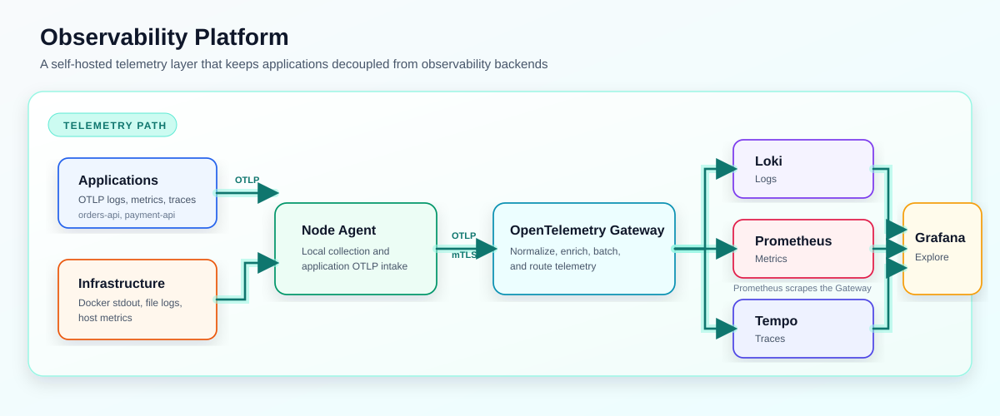
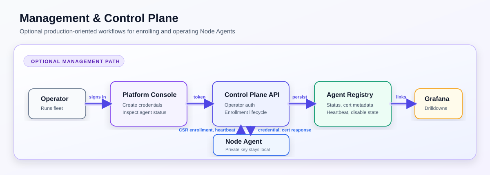
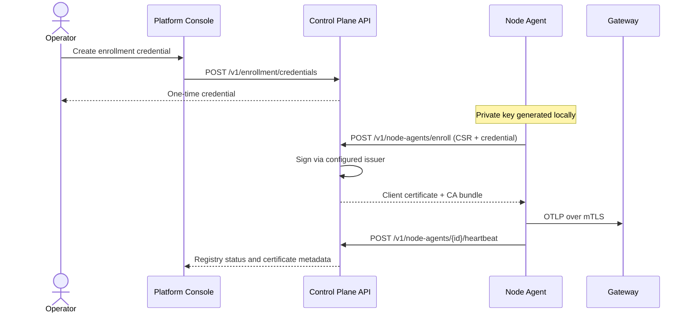
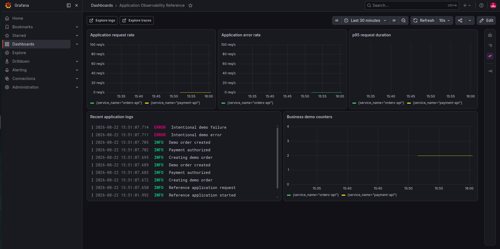
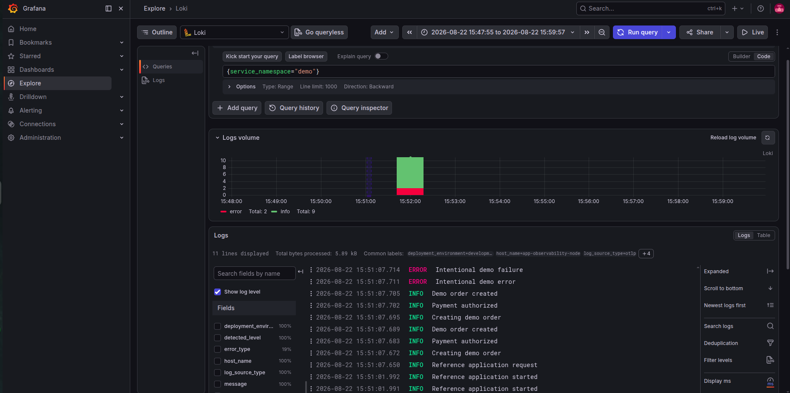
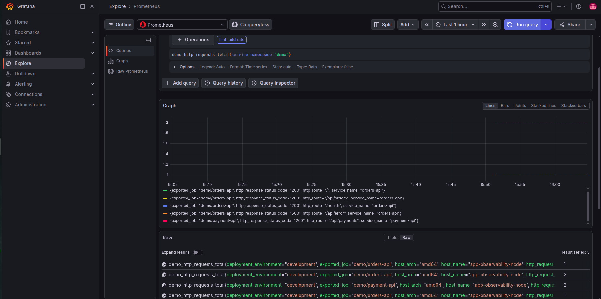
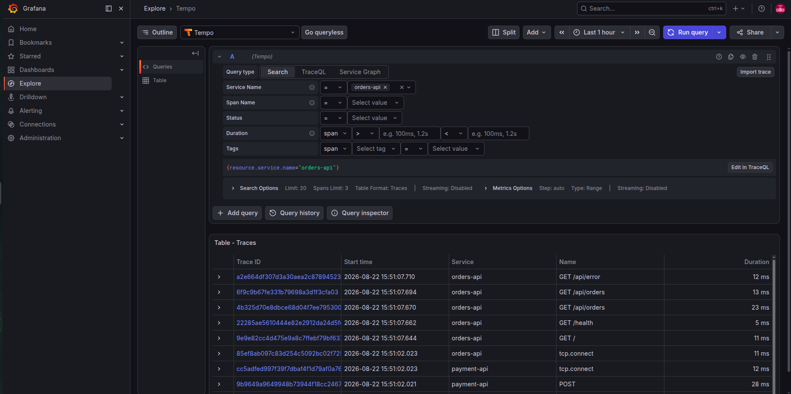

# Observability Platform

Self-hosted logs, metrics, and traces for applications and infrastructure. Built on OpenTelemetry, Grafana, Loki, Prometheus, and Tempo, and deployed with Docker Compose.

[](https://github.com/yashikagarg05/observability-platform/actions/workflows/ci.yml)
[](https://github.com/yashikagarg05/observability-platform/releases)
[](LICENSE)
[](https://opentelemetry.io/)
[](https://docs.docker.com/compose/)



Applications emit OTLP to a Node Agent running on their own host. The Agent also collects Docker stdout, explicitly mounted log files, and host metrics. A central Gateway normalizes, enriches, and routes each signal to Loki, Prometheus, and Tempo, and Grafana is where all three are queried together.

It is aimed at operators who want one telemetry layer for a small fleet of hosts, and at developers who want to emit standard OTLP without knowing which backends exist behind it. Current release is **v0.1.0**, scoped to a single tenant on one host or VM; see [current release and scope](#current-release-and-scope).

**New here?** Run the [local demo](#run-the-local-demo), then [point your own application at it](#integrate-your-own-application).

## Why it exists

Applications should not need to know about log, metric, trace, or dashboard backends, and infrastructure collection should not require every workload to own its telemetry transport. This repository draws that boundary in one place:

- **Node Agents** own node-local collection and application intake.
- **The Gateway** owns centralized processing and backend routing.
- **Backends and Grafana** own storage, querying, and investigation.

Applications emit standard OTLP; operators choose the collection profiles, security controls, and retention behind it. Swapping a backend does not touch application code.

## Architecture

Telemetry flows in one direction, and each layer has a single responsibility:

- **Node Agent** — an OpenTelemetry Collector on each source host. It accepts application OTLP and reads Docker stdout, mounted log files, and host metrics. It contains no backend configuration and exports only OTLP to the Gateway.
- **OpenTelemetry Gateway** — the central Collector. It receives OTLP, normalizes and enriches records, batches them, and routes each signal to its backend.
- **Loki, Tempo, and Prometheus** — the log, trace, and metric stores. The Gateway pushes logs to Loki and traces to Tempo; Prometheus pulls metrics by scraping the Gateway.
- **Grafana** — the query surface, with provisioned datasources, dashboards, and log-to-trace correlation.

Agent enrollment and fleet management run on a separate control path and are not part of the telemetry pipeline:

<details>
<summary><strong>Management and control plane</strong> (optional)</summary>



Enrollment is CSR-only: the Agent's private key is generated on the node and never leaves it. The Control Plane API issues one-time credentials, signs CSRs through a configured issuer, and tracks Agent state in a registry that the Console reads.



The Console covers fleet overview, Agents, enrollment credentials, sites, environments, capabilities, integrations, and settings, with certificate status and fingerprint shown per Agent. It is not a replacement for Grafana, which remains the interface for telemetry itself. The API is versioned under `/v1` and requires a bearer operator token on every endpoint except `/healthz`.

See [Agent Management Lifecycle](docs/agent-management-lifecycle.md) for the full walkthrough.

</details>

## Capabilities

**Collection.** Application OTLP logs, metrics, and traces. Docker `json-file` stdout and stderr. Explicitly mounted log files. Host CPU, memory, disk, filesystem, network, load, and paging metrics.

**Processing.** Serilog and structured-JSON normalization, severity and timestamp parsing, trace-context extraction, resource and service identity enrichment, source provenance, batching, and memory limiting.

**Storage and visualization.** Loki, Prometheus, and Tempo, with provisioned Grafana datasources, three dashboards, and log-to-trace correlation.

**Agent lifecycle.** One-time enrollment credentials, CSR-only enrollment with node-local keys, an Agent Registry, heartbeats, certificate metadata, renewal, and disable/enable controls.

**Transport security.** Optional mTLS between Agent and Gateway with an external issuer boundary. Plaintext OTLP remains available for migration and rollback.

**Operations.** Operator-token API access, persistent Gateway queues for logs and traces, retention controls, health checks, platform self-monitoring, backup and restore scripts, and non-destructive acceptance checks.

**Developer integration.** Point an application at the local Agent with `OTEL_EXPORTER_OTLP_ENDPOINT`, or use `otel-run` to turn an uninstrumented process's stdout into OTLP logs.

<details>
<summary><strong>Node Agent source profiles</strong></summary>

Capabilities (`otlp`, `docker`, `filelog`, `hostmetrics`, `prometheus`) are the building blocks; profiles are the supported combinations. Select exactly one profile per node.

| Profile | Sources |
| --- | --- |
| `otlp` | Application OTLP |
| `docker` | OTLP plus Docker stdout and stderr |
| `docker-file` | OTLP, Docker logs, and one mounted log directory |
| `otlp-hostmetrics` | OTLP plus host metrics |
| `docker-hostmetrics` | OTLP, Docker logs, and host metrics |
| `docker-file-hostmetrics` | OTLP, Docker logs, file logs, and host metrics |

Each profile has a plaintext and an `-mtls` variant. The `prometheus` capability is packaged but intentionally inactive and has no supported profile. See the [Node Agent README](collector/agent) for deployment and transport details.

</details>

## Quick Start

### Prerequisites

A Linux host or VM with Docker Engine and the Docker Compose v2 plugin, plus GNU Make and OpenSSL for the development certificate helpers. Python 3.12 or a compatible Python 3 is used by the Control Plane API, the enrollment scripts, and `otel-run`. Node.js 24 and npm are needed only to build the Console outside Docker.

### Run the local demo

This starts the platform and an instrumented `orders-api` / `payment-api` reference application, using throwaway development mTLS material. It is for evaluation, not production.

```bash
git clone https://github.com/yashikagarg05/observability-platform.git
cd observability-platform

make demo-up
make demo-traffic
```

`make demo-up` creates `.env` if it is missing, generates development certificates under `.tmp/`, starts the stack with the Gateway mTLS overlay, and builds the reference application with its own Node Agent. `make demo-traffic` then drives deterministic requests through both services.

Open Grafana at `http://localhost:3000` and sign in with the `.env` credentials (`admin` / `admin` by default). If port 3000 is taken, set `GRAFANA_PORT` in `.env` first. Use `make demo-ps` to inspect containers, `curl http://localhost:18080/orders` to call the demo app directly, and `make demo-down` to stop everything.

### Integrate your own application

Run the platform centrally and install a Node Agent on each application host; do not clone this repository onto every server. Once the Agent is enrolled, applications send telemetry to it locally:

```bash
OTEL_EXPORTER_OTLP_ENDPOINT=http://localhost:4318
```

For a process that only writes to stdout and is not instrumented, the Agent package includes `bin/otel-run`, which keeps output on the terminal and forwards each line as an OTLP log:

```bash
bin/otel-run --service orders-api -- npm run dev
```

`otel-run` requires Python 3 and reaches the Agent over OTLP HTTP on `localhost:4318`, which only the `otlp` and `otlp-hostmetrics` profiles publish. It cannot reach an Agent running a Docker-only or file-only profile.

Full host workflow: [Integrate Your Application](docs/integrate-your-application.md).

### Add the management console

The Control Plane API and Console are not part of the base stack. Add them to a running demo:

```bash
make demo-management-up      # Control Plane API and Console
make demo-management-agent   # Enroll a sample Agent and send a heartbeat
```

The Console listens on `http://127.0.0.1:4173` and the API on `http://127.0.0.1:8080`, both loopback-only. Sign in with the development operator token `local-management-operator-token-1234567890` for tenant `tenant-a`, or override `DEMO_CONTROL_PLANE_OPERATOR_TOKEN` and `DEMO_CONTROL_PLANE_TENANT_ID`. `make demo-management-agent` issues a credential, generates a key and CSR, enrolls a sample `payments-vm-1` Agent, and sends a heartbeat so it appears in the fleet view. Stop both with `make demo-management-down`.

This path uses the development issuer and throwaway CA material. Production enrollment goes through an external issuer command instead: see [production enrollment and certificate lifecycle](docs/production-enrollment-lifecycle.md).

### Production deployment

The supported path is single-tenant on one host, with a long random operator token and PKI material prepared outside this repository.

```bash
cp deployments/production/production.env.example /etc/observability-platform/production.env
# Edit the file and replace every changeme value.

set -a
. /etc/observability-platform/production.env
set +a

docker compose -f docker-compose.yml \
  -f deployments/docker-compose/production.yaml up -d
```

Set at least the tenant ID, operator token, Grafana password, certificate paths, enrollment PKI path, issuer mode, external issuer command, and trace retention before starting. The [production quickstart](docs/production-quickstart.md) has the full procedure; the [production deployment guide](docs/production-deployment.md) covers retention, recovery, and validation.

> [!IMPORTANT]
> This profile is not highly available, multi-tenant, or a Kubernetes deployment. Work through the [acceptance checklist](docs/production-acceptance-checklist.md) before relying on it.

## Explore in Grafana

Two provisioned dashboards demonstrate the platform against the reference application:

- **Application Observability Reference** — request rate, error rate, latency, recent logs, and demo counters for `orders-api` and `payment-api`.
- **Platform Self-Monitoring** — scrape health, Gateway throughput, export failures, queue depth, CPU, and memory.



<details>
<summary><strong>The same traffic as logs, metrics, and traces</strong></summary>

| Signal | Backend | Example |
| --- | --- | --- |
| Logs | Loki |  |
| Metrics | Prometheus |  |
| Traces | Tempo |  |

</details>

The [application observability guide](docs/application-observability.md) walks through verifying each signal and correlating a log line to its trace.

## Documentation

**Getting started** — [Node Agent onboarding](docs/node-agent-onboarding.md) · [Integrate Your Application](docs/integrate-your-application.md) · [Application observability](docs/application-observability.md)

**Architecture** — [Platform architecture](docs/platform-architecture.md) · [Trace and log correlation](docs/trace-log-correlation.md) · [Docker logging](docs/docker-logging.md)

**Node Agent** — [Agent README](collector/agent) · [Agent management lifecycle](docs/agent-management-lifecycle.md) · [Migration from gateway-local collection](docs/remote-log-collection.md)

**Deployment** — [Production quickstart](docs/production-quickstart.md) · [Production deployment](docs/production-deployment.md) · [Acceptance checklist](docs/production-acceptance-checklist.md)

**Security** — [Node Agent mTLS](docs/node-agent-mtls.md) · [Enrollment MVP](docs/node-agent-enrollment-mvp.md) · [Enrollment and certificate lifecycle](docs/production-enrollment-lifecycle.md) · [Production PKI](docs/production-pki.md)

**Releases** — [Changelog](CHANGELOG.md) · [Compatibility](docs/releases/compatibility.md) · [Image policy](docs/releases/image-policy.md) · [Release process](docs/releases/release-process.md)

## Development

| Command | Purpose |
| --- | --- |
| `make help` | List every available command |
| `make validate` | Base Compose file and Gateway Collector config |
| `make validate-mtls` | Certificate profiles and generated Agent configs |
| `make test` | Python unit tests |
| `make lint` | Python syntax validation |
| `make acceptance` | Non-destructive checks against a running stack |

Targets for the production Compose overlay, the frontend build, and Node Agent packaging are also available via `make help`. CI runs Collector and Compose validation, the frontend build, Python lint and tests, and a hygiene check that rejects tracked secrets, certificates, and build artifacts. [CONTRIBUTING.md](CONTRIBUTING.md) maps each kind of change to the validation it needs.

## Reference

> [!WARNING]
> Check the exposure defaults before using a shared host. Grafana binds to all interfaces with the `admin` / `admin` development password, and the plaintext OTLP ports accept unauthenticated telemetry. Set a strong `GRAFANA_ADMIN_PASSWORD`, restrict `GRAFANA_BIND_ADDRESS`, and prefer the mTLS transport anywhere beyond a local workstation.

| Service | Default | Purpose |
| --- | --- | --- |
| Grafana | `0.0.0.0:3000` | Dashboards, Explore, correlation |
| Gateway OTLP | `4317` gRPC, `4318` HTTP | Plaintext intake |
| Gateway OTLP over mTLS | `4319` | Authenticated Agent transport |
| Control Plane API | `127.0.0.1:8080` | Enrollment and fleet APIs |
| Platform Console | `127.0.0.1:4173` | Operator UI |

Prometheus is published on `127.0.0.1:9090`. Loki, Tempo, and node-exporter stay on the internal Compose network and are reached through Grafana. Every port, bind address, and credential is overridable; [`.env.example`](.env.example) documents the base stack and [`production.env.example`](deployments/production/production.env.example) the production overlay.

Repository layout:

```text
collector/agent        Node Agent: capabilities, profiles, generated configs, enrollment scripts
collector/gateway      Gateway Collector: receivers, processors, exporters, pipelines
services/enrollment    Control Plane API
frontend               Platform Management Console (React and Vite)
grafana                Datasource and dashboard provisioning
loki, prometheus, tempo   Backend configuration
deployments            Compose overlays and production configuration
examples               Instrumented reference application
pki, scripts           Certificate templates, packaging, backup, acceptance tooling
docs, tests            Documentation and Python unit tests
```

## Current release and scope

v0.1.0 is deliberately narrow: one tenant, one host or VM, local persistent storage. It does not provide high availability, backend replication, Kubernetes deployment, multi-tenant isolation, remote Agent upgrades or configuration, a bundled production CA, or Gateway-side certificate revocation. See the [changelog](CHANGELOG.md) for release contents and [compatibility](docs/releases/compatibility.md) for Agent and Gateway version ranges.

Later work may address Kubernetes deployment, replicated storage, deeper CA integration, and stronger Gateway-side authorization. Operational boundaries are tracked in the [production deployment guide](docs/production-deployment.md).

## Contributing

Small, focused pull requests are the easiest to review. [CONTRIBUTING.md](CONTRIBUTING.md) covers the workflow, branch and commit conventions, and expected validation; participation follows the [Code of Conduct](CODE_OF_CONDUCT.md).

Bugs, features, docs issues, and questions each have an [issue template](https://github.com/yashikagarg05/observability-platform/issues/new/choose). A reasonable first loop is `make demo-up`, then `make validate` and `make test`.

## Security

Report vulnerabilities through the [security policy](SECURITY.md) rather than a public issue. For deployment hardening, see the [production PKI guide](docs/production-pki.md) and the [enrollment and certificate lifecycle](docs/production-enrollment-lifecycle.md). Keep private keys, certificates, environment files, tokens, and backups out of the repository.

## License

[Apache License 2.0](LICENSE).
